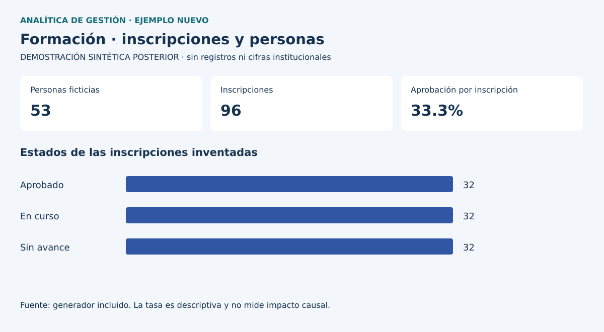

# Analítica para la gestión social

**Ignacio Pizarro Hurtado · Excel, Power BI y calidad de información**

Este portafolio presenta seis casos de mi experiencia en Fundación Hogar de Cristo. El foco es cómo convertí necesidades de las áreas usuarias en análisis, prototipos y reportería, y cómo participé en la actualización y revisión de soluciones existentes.

La documentación histórica revisada cubre principalmente junio de 2022 a febrero de 2024. El vínculo continuó hasta junio de 2024 según el resumen documental; los últimos meses no tienen el mismo detalle de evidencia. No se publican documentos ni capturas institucionales.

## Tres casos principales

| Caso | Aporte documentado |
|---|---|
| [Vinculación institucional y Enredados](casos/01_vinculacion/README.md) | Requerimientos, ETL, prototipos y navegación con botones y marcadores |
| [Escuela de Formación](casos/02_formacion/README.md) | Seguimiento de participación, cursos e identificación de inactividad |
| [Educación Inicial](casos/04_educacion_inicial/README.md) | Limpieza, actualización de libros preexistentes y apoyo al muestreo |

## Otros casos con alcance acotado

- [Calidad de información del CRM](casos/03_calidad_crm/README.md): propuestas y revisión colaborativa de un piloto.
- [Análisis longitudinal](casos/05_longitudinal/README.md): cohortes, permanencia y evolución, con límites de completitud.
- [Exploración predictiva](casos/06_predictiva/README.md): consolidación y exploración declaradas, sin código histórico ni métricas verificables.

## Evidencia que se puede revisar públicamente



**Demostración sintética posterior, creada en octubre de 2026.** La imagen y el código no son entregables laborales históricos. Se incluyen dos ejemplos nuevos y reproducibles: seguimiento de formación y selección de una muestra por programa. No usan datos, cifras, distribuciones ni registros del empleador.

```bash
python src/demostracion.py
python -m unittest discover -s tests -v
```

Los casos separan desarrollo propio, colaboración con BI/TI y mantenimiento. Aceptación de prototipos no se interpreta como despliegue productivo; identificación de inactivos no implica deshabilitación. La cantidad de reportes no acredita seniority.

[Metodología](metodologia.md) · [Fuentes y límites](fuentes_y_limites.md) · [Demostraciones](demostraciones.md) · [Autoría](AUTORIA_Y_USO.md) · [Verificación](VERIFICACION.md)

Portafolio personal sin afiliación, respaldo ni carácter oficial de la organización mencionada.
