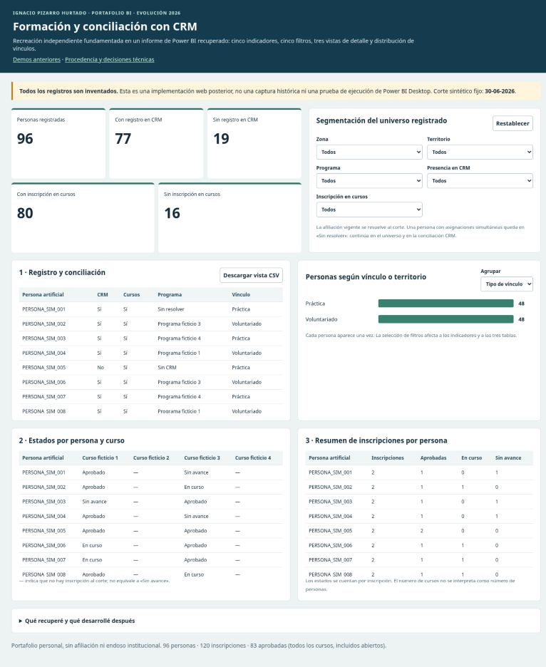

# Analítica para la gestión social · Hogar de Cristo

**Ignacio Pizarro Hurtado · Ingeniero Civil Industrial**  
**Power BI · Excel · Preparación y calidad de datos · Control de gestión**

Durante 2022–2024 desarrollé dashboards, prototipos y análisis para apoyar el seguimiento de formación, vinculación institucional y programas sociales en Hogar de Cristo. Mi trabajo incluyó levantar requerimientos con áreas usuarias, preparar información, construir reportes y colaborar con BI/TI. También mantuve y actualicé soluciones Excel preexistentes.

Este portafolio reúne seis casos de esa experiencia y muestra mi evolución técnica: **qué desarrollé, cuál fue mi responsabilidad y cómo abordaría hoy esos problemas con modelamiento de datos, Power Query, DAX, SQL y Python**. Cada caso diferencia el trabajo histórico acreditado, las propuestas de mejora y las implementaciones posteriores verificadas.

## Explorar el portafolio

- [**Ver la recreación funcional de Escuela de Formación**](https://ipizarroh.github.io/analitica-gestion-social/recuperacion/).
- [Revisar el proyecto Power BI y su protocolo de validación en Desktop](powerbi/recuperacion_formacion/README.md).
- [Explorar las demostraciones de cohortes y asistencia](https://ipizarroh.github.io/analitica-gestion-social/).

La recreación de Formación se basa en la estructura del reporte histórico recuperado: conserva cinco indicadores, cinco filtros, tres tablas y una distribución por vínculo. Incorpora controles posteriores para determinar la afiliación vigente a una fecha de corte y separar los registros con información contradictoria.

**La demostración es una implementación web de 2026 con datos completamente sintéticos.** Permite explorar los cálculos y las interacciones; la validación del nuevo proyecto en Power BI Desktop permanece pendiente.



## Seis casos: mi contribución y evolución técnica

| Caso | Mi contribución histórica acreditada | Cómo lo abordaría hoy |
|---|---|---|
| [Vinculación institucional y Enredados](casos/01_vinculacion/README.md) | Levantamiento de requerimientos, trabajo con extractos recibidos, prototipos y navegación del reporte; colaboración con BI/TI. | Modelar actividades, instituciones y sus relaciones para analizar la participación sin duplicar resultados. |
| [Escuela de Formación](casos/02_formacion/README.md) | Elaboración de reportes, prototipos y seguimiento mensual con Excel y Power BI. | Separar personas e inscripciones, resolver afiliaciones por fecha y conciliar indicadores. Incluye una recreación funcional. |
| [Calidad y gobierno de datos del CRM](casos/03_calidad_crm/README.md) | Análisis de categorías, propuesta remitida a TI y revisión colaborativa del piloto de autorregistro. | Diseñar catálogos con vigencia, reglas de calidad y seguimiento de excepciones con responsables. |
| [Educación Inicial y asistencia](casos/04_educacion_inicial/README.md) | Actualización de libros existentes, participación en muestreo y desarrollo de botones de navegación. | Distinguir jornadas esperadas, asistencia registrada y cobertura de datos para interpretar correctamente los resultados. |
| [Trayectorias sociales](casos/05_longitudinal/README.md) | Elaboración colaborativa de análisis sobre bases facilitadas por jefatura. | Definir episodios, cohortes y mediciones comparables, considerando seguimientos incompletos y sesgos de selección. |
| [Exploración predictiva y medición de programas](casos/06_predictiva/README.md) | Consolidación y exploración supervisada con RStudio y Power BI. | Revisar la preparación de datos y la evaluación estadística antes de proponer modelos de conteos por programa. |

Cada caso desarrolla **«Cómo lo desarrollé entonces y cómo lo abordaría hoy»**: problema de gestión, herramientas, responsabilidad, fortalezas, limitaciones, arquitectura propuesta y pruebas necesarias. Las propuestas se presentan como tales; los resultados operativos solo se afirman cuando existe evidencia que los respalde.

## Evidencia técnica que puedes revisar

- **[Modelamiento de datos](datos_recuperacion/README.md):** granularidad documentada, separación entre personas e inscripciones y diccionario de datos.
- **[ETL y calidad](src/recuperacion.py):** transformaciones reproducibles, detección de duplicados, referencias sin correspondencia y afiliaciones contradictorias.
- **[Power Query, DAX y proyecto Power BI](powerbi/recuperacion_formacion/):** consultas y medidas nuevas, relaciones unidireccionales y definición de quince visuales.
- **[Pruebas automatizadas](tests/):** 25 pruebas Python aprobadas, conciliación con SQL y comparación de resultados entre Python y JavaScript.
- **[Validación y límites](VERIFICACION.md):** archivos JSON/PBIR comprobados contra esquemas públicos de Microsoft. La ejecución de DAX y M, la actualización de datos y la visualización en Power BI Desktop están pendientes.

<details>
<summary>Reproducir los desarrollos y ejecutar las pruebas</summary>

Desde la raíz del repositorio, con las dependencias del proyecto instaladas:

```bash
python src/evolucion.py
python src/construir_web.py
python src/recuperacion.py
python src/construir_recuperacion.py
python src/construir_powerbi_recuperacion.py
python -m unittest discover -s tests -v
node tests/test_web.mjs
node tests/test_recuperacion.mjs
```

</details>

## Procedencia, autoría y confidencialidad

La revisión histórica examinó 21 PBIX originales y once copias adicionales en comprimidos, correspondientes a 27 versiones distintas por SHA-256, además de libros Excel, código R, documentos y capturas. Estos materiales permiten fundamentar los casos y delimitar mi participación. Los originales y la trazabilidad detallada permanecen privados.

**El código y los datos publicados corresponden a desarrollos posteriores**, identificados por separado de mi trabajo laboral de 2022–2024. La IA se utilizó como asistencia para la reconstrucción, el desarrollo posterior y la documentación. Mi autoría histórica y las colaboraciones acreditadas se describen en cada caso.

[Autoría y uso](AUTORIA_Y_USO.md) · [Recuperación histórica](recuperacion_historica.md) · [Fuentes y límites](fuentes_y_limites.md) · [Historial de cambios](CHANGELOG.md)

*Portafolio profesional personal, sin afiliación ni endoso institucional.*
