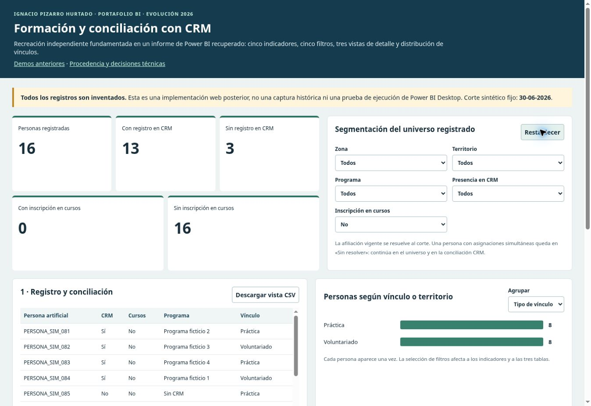

# Verificación y límites

Las pruebas se reproducen desde un clon limpio con los comandos del README. Python/SQL validan reglas y agregados artificiales; JavaScript contrasta cálculos del visor contra Python. El workflow ejecuta contratos, paridad y regeneración.

## Fase 3

- 25 pruebas Python aprobadas, incluidas diez nuevas de universo, duplicados, conflictos, temporalidad, orden, huérfanos y SQL independiente.
- Paridad de la nueva vista: siete contextos / 56 resultados. Se conservan los 15 contextos / 111 valores de las demos previas.
- Candidato PBIR: 21 archivos JSON validados contra esquemas públicos de Microsoft, con referencias y datos sintéticos revisados. Modelo TMSL y expresiones se revisan estáticamente.
- Regeneración determinista de datos, HTML y candidato nativo.

Power BI Desktop, Excel nativo, DAX Studio, Performance Analyzer y ejecución DAX/M **no se realizaron** en Linux. La validación JSON y la vista web no sustituyen apertura, refresh, interacción, guardado y reapertura nativos. No se atribuye mejora de rendimiento al motor.

La extracción privada de modelos se realizó localmente con PBIXRay 0.15.5, de solo lectura. No se ejecutaron las consultas ni el R histórico. Hubo errores del extractor en algunos modelos Power Pivot: el detalle privado conserva cada resultado; no se confunden con fallas del libro en Excel.

La revisión de publicación compara identificadores/rutas de fuentes, inspecciona contenido y bloquea originales, contactos y secretos. Es un control técnico y editorial, sin certificar derechos de publicación de los originales, que quedan excluidos. Las capturas publicadas son solo de demostraciones sintéticas posteriores.

Publicación verificada: [PR #3](https://github.com/ipizarroh/analitica-gestion-social/pull/3), merge `89044d7aa3d15277d49d79e251515c9d11b5209a`, [CI aprobada](https://github.com/ipizarroh/analitica-gestion-social/actions/runs/39005905954). Un clon anónimo reprodujo las 25 pruebas y ambas paridades. En navegador se conciliaron ocho estados de indicadores, se cambió la agrupación y se exportaron 16 filas sin cursos; no se observaron errores de aplicación, y los avisos de extensión se conservaron por separado. Véase [historial de cambios](CHANGELOG.md) y [protocolo Desktop](powerbi/recuperacion_formacion/README.md).

Capturas reales del visor web publicado. No son capturas institucionales ni render de Power BI Desktop.
