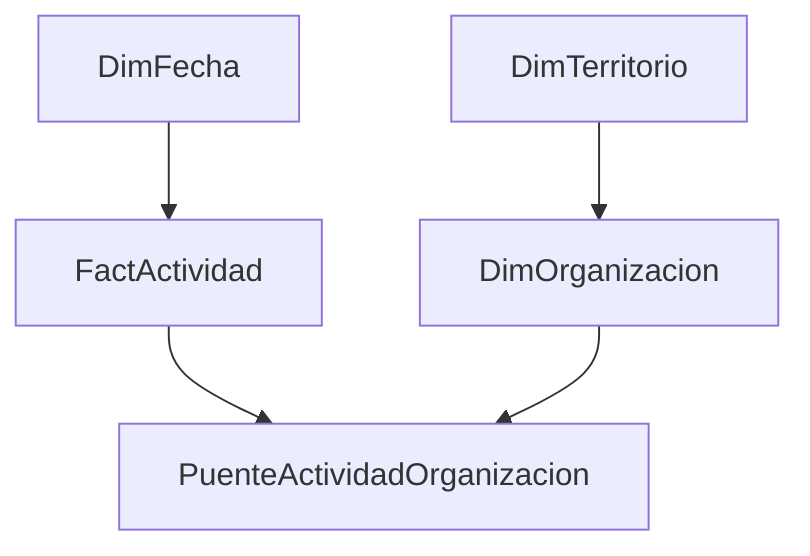

# Vinculación institucional y Enredados

## Problema de gestión

Las áreas de vinculación necesitaban una lectura territorial de sus relaciones con instituciones educativas y otras organizaciones. La información histórica existía en el CRM, pero requería preparación y una forma de navegación comprensible para usuarios sin especialización en Power BI.

Las preguntas eran qué tipos de actividades se realizaban, cómo se distribuía la participación y cómo explorar redes y territorios sin recorrer informes desconectados.

## Mi rol y colaboración

Recopilé necesidades de las áreas solicitantes, coordiné la recepción de extracciones del CRM, limpié y organicé información y desarrollé prototipos en Excel y Power BI. Colaboré con BI en modelamiento y preparación para su eventual integración. El informe aclara que solicitaba las bases: no acredita acceso directo propio al CRM.

En Enredados organicé una navegación guiada con botones y marcadores para reunir las áreas trabajadas en un recorrido común. Esta participación se documenta como desarrollo de prototipos y navegación, sin atribuirme la totalidad de la plataforma institucional.

## Metodología acreditada

1. Levantamiento de requerimientos y coordinación de fuentes.
2. Preparación y transformación de las extracciones recibidas.
3. Construcción de prototipos y revisión con las áreas usuarias.
4. Ajustes y entrega al referente BI para la integración posterior prevista.

Se documentan Excel, Power Query, Power Pivot y Power BI. El informe menciona aprendizaje y uso de M y DAX, pero no contiene un repositorio histórico de fórmulas ejecutables. No se reconstruyen expresiones atribuyéndolas al período laboral.

## Indicadores y visualización

Se trabajó con actividad institucional, participación, distribución por tipo de vínculo y lectura territorial. Las imágenes privadas muestran filtros, tarjetas, gráficos y tablas, además del menú de navegación. Aquí se describe el propósito sin reproducir valores, instituciones individualizables, logos ni capturas.

## Resultado demostrado y límites

La documentación acredita prototipos y su aceptación en reuniones. No prueba por sí sola su publicación efectiva en el informe oficial, actualización automática ni uso sostenido. Las mejoras esperadas en convocatoria y estrategia no se presentan como efectos medidos.

Trazabilidad: H01 y H02 en el registro privado de evidencia. Estado: CONFIRMADO como trabajo documentado; despliegue y efectos posteriores NO ACREDITADOS.

## Aprendizajes transferibles

La utilidad del dashboard depende de acordar preguntas y términos con sus usuarios. Una navegación sencilla puede reducir esfuerzo de exploración, pero requiere comprobar interacciones y comprensión antes de presentarla como una mejora operativa medida. El caso muestra preparación de datos, colaboración y diseño de información con alcance concreto.

## ¿Cómo lo abordaría hoy? Evolución técnica y profesional (2026)

### Objetivo, usuarios y alcance histórico

Para equipos de vinculación y referentes BI, mantendría la navegación guiada y las reuniones de validación de prototipos que desarrollé. El informe privado (págs. 7–23) documenta requerimientos, preparación de extracciones recibidas, prototipos y botones/marcadores. La integración productiva posterior no está acreditada.

### Diagnóstico retrospectivo

La falta de código y bases históricos impide demostrar duplicaciones concretas. Trataría la multiplicidad actividad–institución como **riesgo a comprobar**, no como error probado. Separaría actividad, organización y participación para impedir que una actividad con varias instituciones se contabilice varias veces al sumar territorios. Conservaría los nombres de negocio acordados y replantearía la distribución de páginas alrededor de decisiones.

| Pregunta nueva | Datos necesarios | Viabilidad actual |
|---|---|---|
| ¿Cuántas actividades únicas se realizaron? | ID actividad, fecha, estado | Requiere datos históricos no disponibles |
| ¿Qué territorios tienen vínculos activos sin actividad reciente? | Vigencia de vínculo y eventos fechados | Requiere datos y acuerdo de ventana |
| ¿Las actividades causaron mayor involucramiento? | Diseño de evaluación, exposición, comparación | No justificable con el informe |

### Modelo y procesamiento propuestos

Granos: una actividad; una pareja actividad–organización; una organización con territorio vigente al evento si el análisis lo exige. Relaciones 1:* en una dirección. La selección territorial llega al puente, por lo que una medida de actividad filtrada debe usar `TREATAS(VALUES(PuenteActividadOrganizacion[actividad_id]), FactActividad[actividad_id])`, con `DISTINCTCOUNT` del hecho. No habilitaría bidireccionalidad general para esconder el problema. Participantes totales permanecerían al grano actividad: no sumarlos por institución sin regla de asignación.

Power Query conservaría RAW recibido y fecha de extracción, normalizaría claves como texto, separaría catálogos y pondría registros huérfanos en cuarentena. Pruebas: ID único de actividad, pareja única en puente, FK válidas y total de actividad estable al expandir instituciones. [Diseño detallado](../../disenos/01_enredados.md).

### Experiencia de usuario y operación

Menú por propósito (cobertura, actividad, seguimiento), fechas y territorio visibles, una tabla de excepciones y definiciones en tooltip. Probaría navegación por teclado y reinicio de filtros con usuarios. Contactos no entrarían en la capa pública; acceso institucional requeriría matriz de permisos, responsables de extracción y retención, sin presumir RLS ya implementado.

| Antes acreditado | Propuesta actual | Riesgo / trade-off | Prioridad y aceptación |
|---|---|---|---|
| Prototipos y navegación guiada | Contrato y puente explícito | Mayor complejidad de medidas | P1: total no aumenta al agregar instituciones |
| Extractos coordinados con BI | Entrega versionada y conciliación | Depende del área fuente | P1: cada carga tiene corte y filas conciliadas |
| Aceptación en reuniones | Tareas de usuario y evidencia de uso | Requiere disponibilidad usuaria | P2: completar recorrido sin perder filtro |

Estado: **IDEA → DISEÑO**. No hay demo ni publicación de un Enredados reconstruido. Se priorizó profundizar el riesgo muchos-a-muchos, mientras las dos implementaciones sintéticas se concentraron en Formación y Educación Inicial.

### Estado de esta evolución

El trabajo histórico y la reconstrucción posterior se evalúan por separado. Las propuestas de seguridad y operación no acreditan funciones desplegadas durante mi experiencia laboral. No se publican capturas ni datos institucionales. Los documentos privados permiten contrastar el relato; las pruebas públicas corresponden exclusivamente a código nuevo y datos artificiales.
