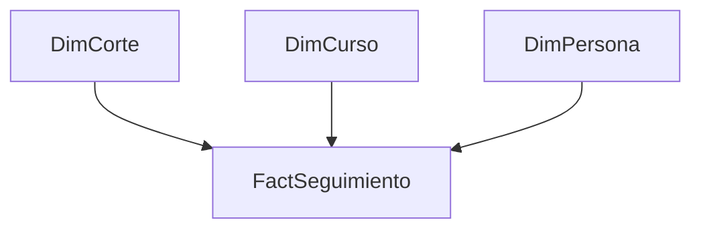
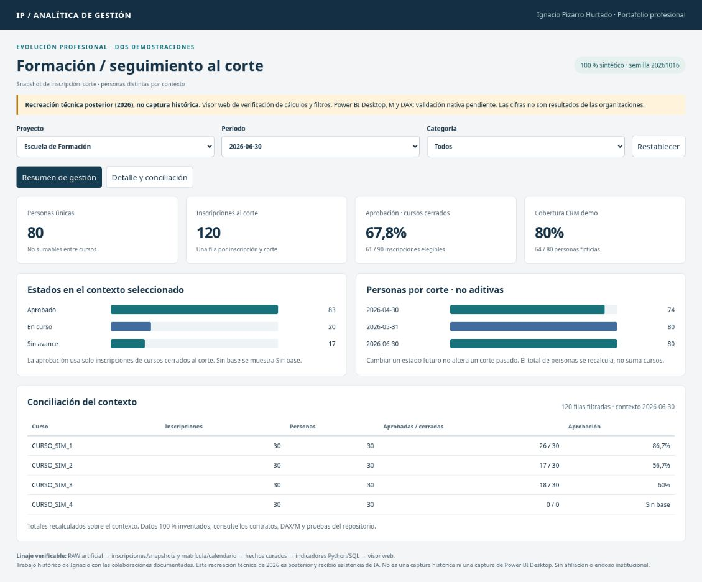

# Escuela de Formación: participación y seguimiento

## Problema y preguntas

El equipo necesitaba comprender el flujo de participantes, sus inscripciones y estados de cursos, así como identificar cuentas sin actividad para su revisión. La reportería debía relacionar información de la plataforma formativa y registros disponibles del CRM.

Las preguntas incluían cuántas personas tenían registro, quiénes habían inscrito cursos, cómo cambiaban los estados y qué grupos requerían seguimiento. Las cantidades y los listados originales permanecen privados.

## Mi participación

Preparé reportes en Power BI y Excel, construí y ajusté prototipos mediante reuniones de retroalimentación y participé en la reportería mensual. La documentación explica que se generaban nuevos reportes utilizando nombres de tablas y medidas de versiones anteriores. No acredita una conexión automática desplegada al CRM.

También identifiqué usuarios inactivos para evaluación posterior. La entrega de un listado no demuestra que las cuentas fueran deshabilitadas, que se liberara capacidad ni que se redujeran costos.

## Procedimiento respaldado

Se consolidó información disponible de participación y contacto a nivel privado, se contrastaron registros con el CRM y se organizaron vistas por cursos, estados y tipo de vínculo. Se revisaron prototipos con el equipo solicitante y se reutilizó la lógica de reportes anteriores para nuevos cortes.

Los indicadores descritos incluyen personas registradas, presencia o ausencia de registro CRM, inscripción a cursos y estados de participación. Las fórmulas exactas y la definición operativa histórica de inactividad no están disponibles como código: no se inventan.

## Resultado y evaluación prudente

El informe y sus capturas documentan reportes de formación y un ejercicio de identificación de inactividad. Para campañas se describe una asociación temporal, pero no hay bases originales, comparación causal ni denominadores suficientes para sostener una mejora atribuible. Se evita afirmar que la campaña aumentó la participación en una magnitud comprobada.

Trazabilidad privada: H03 y H04. Estado: CONFIRMADO para existencia de reportería e identificación; PARCIAL para interpretación de campañas; impacto causal y deshabilitación NO ACREDITADOS.

## Demostración posterior y aprendizaje

La [demo nueva](../../demostraciones.md) separa personas, inscripciones y resultados de cursos con identificadores enteramente inventados. Define sus propios denominadores y no reproduce reglas institucionales. El aprendizaje transferible es distinguir persona registrada, inscripción, aprobación e inactividad antes de comparar tasas o recomendar una intervención.

## ¿Cómo lo abordaría hoy? Evolución técnica y profesional (2026)

### Objetivo, usuarios y contribución acreditada

Mantendría la reportería por cursos y el trabajo iterativo con la Escuela. Desarrollé reportes y prototipos y preparé identificaciones para revisión (págs. 24–28, 40–43). La evidencia no acredita deshabilitación de cuentas ni ahorro obtenido. La fuente contiene una interpretación favorable de una campaña que no queda sustentada por la comparación visual mostrada; la retiraría como conclusión de impacto.

### Diagnóstico y nuevas preguntas

La confusión entre personas e inscripciones es un riesgo analítico, no un defecto histórico demostrado sin las bases. Comparar estados actuales entre meses puede introducir información futura: conservaría snapshots de cada corte. No llamaría inactivo a quien no tenga actividad sin acordar primero la definición y verificar integridad de la plataforma.

| Pregunta | Fuente / campo | Viabilidad |
|---|---|---|
| ¿Cuántas personas e inscripciones hay al corte? | Inscripción, persona, fecha y snapshot | Calculable en demo inventada; histórico requiere bases |
| ¿Qué proporción aprueba entre cursos ya cerrados? | Fin de curso y estado al corte | Calculable en demo con denominador explícito |
| ¿Cuánto ahorra desactivar cuentas? | Contrato de licencias, autorización y acciones | Requiere datos; no inferir del listado |
| ¿Qué efecto tuvo una campaña? | Exposición, grupo comparable y seguimiento | No justificable con la evidencia disponible |

### Modelo, ETL y medidas actuales

Grano de hecho: inscripción–corte. El ETL une inscripciones, estado observado y fecha de fin del curso; bloquea duplicados, huérfanos y snapshots anteriores a inscripción. Las personas se cuentan distintas en el contexto, no sumando cursos. El KPI de aprobación considera solo cursos cerrados al corte, y exige un corte único. La cobertura CRM usa personas, no inscripciones. [DAX y Power Query](../../powerbi/evolucion/) y [diseño detallado](../../disenos/02_formacion.md).

La demo prueba que cambiar un snapshot futuro no altera abril. `HASONEVALUE(DimCorte[corte])` protegerá en DAX la suma indebida de snapshots; DAX/M siguen pendientes de ejecución Desktop. No sustituiría cobertura CRM por calidad integral de identidad.

### Visuales, mantenimiento y seguridad

Resumen con personas, inscripciones y denominador de cursos cerrados, seguida de distribución de estados, evolución por corte y lista de excepciones. Selector de corte obligatorio; los filtros no cambian el significado del indicador. En producción, separar contacto del modelo analítico, restringir acciones sobre cuentas y registrar aprobación humana antes de cualquier baja. Mantener contrato de estados y prueba de no fuga temporal en cada cambio.

| Antes | Propuesta actual | Trade-off / riesgo | Aceptación |
|---|---|---|---|
| Reportes mensuales reutilizados | Snapshots versionados | Más almacenamiento | Abril permanece invariable tras carga de junio |
| Seguimiento de estados | Denominador por curso cerrado | Excluye cohortes inmaduras | Sin curso cerrado devuelve ausencia, no 0% |
| Identificación para evaluación | Bandeja de revisión con autorización | No automatiza bajas | No se ejecuta ninguna desactivación |

Estado: **DISEÑO + IMPLEMENTACIÓN SINTÉTICA PROBADA (Python/SQL/navegador)**; **VALIDACIÓN DESKTOP PENDIENTE**. La recreación de 2026 no es el dashboard histórico.

### Estado de esta evolución

El trabajo histórico y la reconstrucción posterior se evalúan por separado. Las propuestas de seguridad y operación no acreditan funciones desplegadas durante mi experiencia laboral. No se publican capturas ni datos institucionales. Los documentos privados permiten contrastar el relato; las pruebas públicas corresponden exclusivamente a código nuevo y datos artificiales.

## Evidencia de ejecución de la recreación

Recreación técnica posterior (2026), no captura histórica. Captura real del visor web; Power BI Desktop pendiente. [Explorar la demo](https://ipizarroh.github.io/analitica-gestion-social/).
