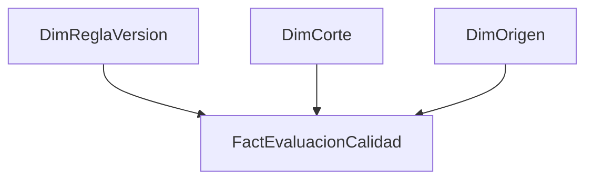

# Calidad de información del CRM

## Problema

La variedad de categorías institucionales y los registros incompletos dificultaban una lectura consistente de la vinculación. Se trabajó en propuestas de recategorización y en la revisión de un piloto de autorregistro.

## Participación y método documentados

Analicé comportamientos de categorías en Power BI y participé en reuniones con referentes del proceso para preparar una propuesta que se remitió a TI. En autorregistro revisé avances del diseño de solución entregado por TI junto con otras personas del equipo. No se atribuye desarrollo íntegro del sistema ni acceso directo autónomo al CRM.

El método consistió en examinar frecuencia y actividad por categoría, discutir agrupaciones y revisar la solución propuesta. Las tablas y reglas institucionales originales no se publican ni se transforman en un catálogo público.

## Resultado, límites y aprendizajes

Se acredita la propuesta y su comunicación, y la revisión de un diseño todavía en proceso. La implementación productiva, mejoras de completitud y reducción de tiempos no están acreditadas. Trazabilidad privada H05: CONFIRMADO como participación documental, efectos posteriores NO ACREDITADOS.

El caso demuestra que calidad requiere acuerdos semánticos y responsabilidad de mantenimiento. Para una implementación actual sería necesario versionar reglas, conservar valores de origen y medir cobertura de la clasificación. Son propuestas posteriores, no funcionalidades históricas demostradas.

## ¿Cómo lo abordaría hoy? Evolución técnica y profesional (2026)

### Alcance histórico y diagnóstico

Para referentes de vinculación y TI, mantendría la revisión colaborativa y la comunicación de propuestas de categorías (págs. 28–32). Mi aporte fue análisis y revisión del piloto diseñado por TI; no implementación integral del autorregistro. La falta de base y reglas versionadas disponibles impide medir defectos históricos. Una taxonomía gobernada es una oportunidad propuesta, no una reparación demostrada.

| Pregunta actual | Requisito | Viabilidad |
|---|---|---|
| ¿Qué proporción puede clasificarse con reglas vigentes? | Valor origen, regla, versión, corte | Requiere datos y taxonomía aprobada |
| ¿Dónde se concentran valores sin correspondencia? | ID registro y área responsable | Requiere extracción autorizada |
| ¿Mejoró la captación tras recategorizar? | Seguimiento y diseño causal | No justificable con este material |

### Diseño técnico propuesto

Grano: registro–regla–corte, distinto de registro de institución. ETL conserva valor original en zona restringida, genera candidato normalizado y asigna categoría mediante tabla de correspondencia con fechas de vigencia. Los desconocidos se cuarentenan; no se inventa categoría para aumentar cobertura. `Registros evaluados = DISTINCTCOUNT(FactEvaluacionCalidad[registro_id])`; no contar filas de reglas como personas. `% incumplimiento regla = DIVIDE([Registros incumplen],[Registros evaluados])` solo en contexto de una regla y corte.

Pruebas: vigencias no solapadas, una correspondencia por valor/corte, FK de regla, total recibido = aceptado + cuarentena y conservación de claves. Publicaría agregados seguros; el historial de corrección y contactos quedaría restringido. Responsable de negocio aprueba cambios y TI opera el catálogo. Cada actualización compararía tasas con el mismo universo, sin convertir corrección en eliminación silenciosa.

### UX y decisiones

Página de excepciones por regla con cantidad y porcentaje, responsable y estado de revisión; drillthrough restringido si contiene identidad. Navegación separada entre diagnóstico y acciones para evitar que una alerta ejecute cambios en CRM.

| Antes | Propuesta actual | Riesgo / trade-off | Prioridad y aceptación |
|---|---|---|---|
| Propuesta remitida a TI | Catálogo aprobado versionado | Exige gobierno continuo | P1: ninguna regla sin dueño y vigencia |
| Revisión de categorías | Cuarentena y conciliación | Puede reducir cobertura aparente | P1: sin registros perdidos |
| Revisión del piloto | Pruebas y reversión | Más trabajo de liberación | P2: restaurar versión sin modificar RAW |

Estado: **IDEA + DISEÑO**. Sin implementación sintética adicional ni validación Desktop; no se fabricó un CRM institucional.

### Estado de esta evolución

El trabajo histórico y la reconstrucción posterior se evalúan por separado. Las propuestas de seguridad y operación no acreditan funciones desplegadas durante mi experiencia laboral. No se publican capturas ni datos institucionales. Los documentos privados permiten contrastar el relato; las pruebas públicas corresponden exclusivamente a código nuevo y datos artificiales.
