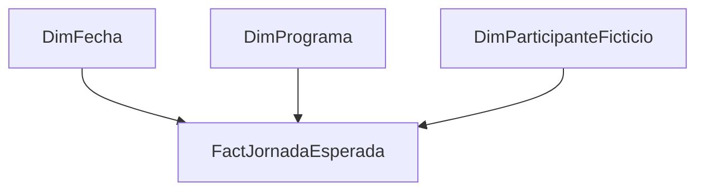

# Educación Inicial: actualización de asistencia y apoyo al muestreo

## Necesidad de gestión

Los equipos requerían reportes actualizados de asistencia y un consolidado que apoyara la revisión de información utilizada en procesos de incentivos. La lectura dependía de distinguir capacidad, matrícula, días hábiles y registros efectivamente recibidos.

Las preguntas eran qué cobertura tenía el registro, cómo evolucionaba la asistencia y cómo seleccionar casos para revisión. No se publican registros de niños, matrículas, programas individualizables ni cifras institucionales.

## Mi rol preciso

Actualicé reportes Excel que ya estaban construidos. Limpié la base recibida, la cargué en una hoja del libro y actualicé sus tablas dinámicas. Para el consolidado recibí capacitación de un colega y actualicé registros y selección aleatoria. El documento también atribuye al autor botones de navegación del consolidado.

Ese trabajo no se presenta como diseño original de todo el libro, de sus cálculos ni del esquema de incentivos. Tampoco se atribuye una decisión sobre pagos o elegibilidad a la reportería realizada.

## Metodología e indicadores respaldados

La documentación describe actualización semanal, revisión de vistas de programas y uso de números aleatorios para apoyar selección de participantes. Entre los indicadores mencionados están capacidad, matrícula, cobertura del registro, promedio diario de asistencia y proporciones de asistencia o ausencia. Sin el libro original no se certifican sus denominadores, fórmulas ni reglas de días justificados.

La selección aleatoria histórica está documentada, pero no hay código ni semilla que permita reproducir la muestra original. No se afirma representatividad estadística ni validez de un diseño muestral formal no documentado.

## Resultado demostrado y límites

El resultado verificable es la actualización de reportes preexistentes y apoyo al proceso de revisión. No se demuestra una mejora cuantificada de asistencia, equidad o precisión de incentivos. Las capturas sirven como evidencia privada del formato del trabajo, no como material publicable.

Trazabilidad privada H06. Estado: CONFIRMADO para actualización y apoyo al muestreo. Autoría íntegra del sistema e impacto cuantificado NO ACREDITADOS.

## Aprendizaje y demostración posterior

Mantener un reporte exige comprender las fórmulas heredadas, revisar cortes y reconocer el alcance de la propia intervención. La demo nueva usa programas abstractos e IDs inventados, selección sin reemplazo y semilla fija. Ilustra reproducibilidad técnica; no replica la política institucional ni se utiliza para decisiones reales sobre personas.

## ¿Cómo lo abordaría hoy? Evolución técnica y profesional (2026)

### Objetivo y contribución histórica

Para equipos de Educación Inicial, mantendría la periodicidad de revisión y la navegación que ayudé a incorporar. Actualicé libros ya construidos y recibí capacitación de un colega para consolidado y selección (págs. 28–32 y 39–46). No me atribuiría el diseño íntegro del sistema ni decisiones de incentivos. Sin libro fuente no se demuestra un error en sus fórmulas.

### Retrospectiva y preguntas nuevas

La no reproducibilidad de la muestra histórica desde el material recibido está demostrada por ausencia de semilla/código; no prueba que la selección fuera incorrecta. La posible confusión entre ausencia y dato no recibido es un riesgo a comprobar. Lo resolvería construyendo el universo esperado antes de unir observaciones.

| Pregunta | Campos | Viabilidad |
|---|---|---|
| ¿Cuántas jornadas deberían estar informadas? | Matrícula vigente y días abiertos | Calculable en demo; histórico requiere calendario |
| ¿Cuál es la asistencia entre jornadas recibidas y esperadas? | Presente/ausente y cobertura | Calculable en demo con dos denominadores |
| ¿Qué incentivo corresponde? | Política formal, justificaciones y validación | No justificable desde la demo |

### Modelo y procesamiento

Grano: participante–día abierto con matrícula vigente. Una unión izquierda con asistencia conserva `Sin registro` como estado distinto de `Ausente`. `Cobertura = DIVIDE([Jornadas recibidas],[Jornadas esperadas])` y `Asistencia observada = DIVIDE([Presentes],[Jornadas recibidas])`. El producto de ambas concilia con presentes/esperadas cuando hay base. No usar capacidad física como denominador de asistencia individual. [Diseño detallado](../../disenos/03_educacion.md).

Pruebas: participante–fecha único, ningún registro fuera de matrícula o en cierre, suma de estados igual al universo, días sin base devuelven ausencia y totales por programa conciliados. El generador inventa un cierre; no reproduce feriados ni clima. Se conserva la demo previa de muestreo sin reemplazo y semilla fija como ejercicio separado, sin afirmar representatividad ni replicar incentivos.

### Visualización, seguridad y operación

Primero cobertura y pendientes; luego asistencia observada. Evitar semáforos que penalicen programas con registro incompleto. Tabla por programa con numeradores y denominadores visibles, filtro temporal y definición de cierre. En uso real, minimizar datos de menores, evitar exportación nominal y revisar supresión de celdas pequeñas. No se afirma haber implementado RLS. El responsable del calendario valida cierres y el del programa resuelve faltantes; recargas idempotentes con bitácora.

| Antes | Propuesta actual | Riesgo / trade-off | Aceptación |
|---|---|---|---|
| Actualización de libro preexistente | Universo esperado + observaciones | Requiere matrícula/calendar confiables | P1: 0 huérfanos, 0 duplicados |
| Reportería de asistencia | Cobertura separada de asistencia | Más indicadores que explicar | P1: faltante nunca se vuelve ausente |
| Selección aleatoria de apoyo | Semilla y población versionadas | No sustituye diseño estadístico | P2: selección reproducible, sin reemplazo |

Estado: **DISEÑO + IMPLEMENTACIÓN SINTÉTICA PROBADA (Python; navegador pendiente)**; **VALIDACIÓN DESKTOP PENDIENTE**. No es una reconstrucción de datos ni decisiones sobre niños reales.

### Estado de esta evolución

El trabajo histórico y la reconstrucción posterior se evalúan por separado. Las propuestas de seguridad y operación no acreditan funciones desplegadas durante mi experiencia laboral. No se publican capturas ni datos institucionales. Los documentos privados permiten contrastar el relato; las pruebas públicas corresponden exclusivamente a código nuevo y datos artificiales.
