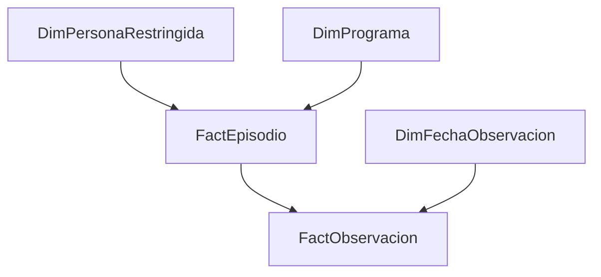

# Análisis longitudinal de cohortes y trayectorias

## Necesidad y participación

Se requería examinar evolución temporal, permanencia y composición de cohortes para apoyar análisis de gestión. Construí vistas de ingresos y egresos, columnas analíticas y tablas de seguimiento en colaboración con referentes del área. Para una parte del estudio, la tabla base provenía de jefatura y mi trabajo continuó sobre ella.

## Método documentado

El informe describe cohortes definidas por año de ingreso, revisión de personas únicas, permanencia y observaciones sucesivas. Excel se menciona expresamente en el análisis de trayectorias. La documentación contiene resultados visuales privados, pero no bases ni código original suficientes para reproducirlos.

## Resultado y límites

Se acredita una elaboración analítica con avances y salidas mostradas en el informe. Parte del relato todavía plantea pasos de cierre o réplica. No se declara un sistema productivo, una evaluación de impacto ni resultados causales. No se publican cifras ni variables personales sensibles, aunque aparezcan agregadas en la fuente.

Trazabilidad H07: PARCIAL para completitud y reproducibilidad. La lección transferible es definir cohorte, fecha de corte, reingresos y datos faltantes antes de interpretar cambios. Esos controles se proponen como mejora actual; no se atribuyen al código histórico ausente.

## ¿Cómo lo abordaría hoy? Evolución técnica y profesional (2026)

### Histórico y diagnóstico

Para analistas y referentes de programas, mantendría cohortes explícitas y el trabajo colaborativo sobre bases facilitadas por jefatura. El informe (págs. 46–50) acredita elaboración de vistas y modificaciones, con tareas de cierre o réplica todavía pendientes. La completitud/reproducibilidad histórica es parcial; no hay evidencia suficiente para declarar un error numérico concreto.

| Pregunta | Datos requeridos | Viabilidad |
|---|---|---|
| ¿Qué proporción de una cohorte sigue observada al mes 6? | Episodios, observaciones y corte | Requiere base longitudinal y definición |
| ¿Cómo tratar reingresos y pérdida de seguimiento? | ID persona, episodio, causa de egreso | Requiere acuerdo de negocio |
| ¿El programa causó una mejora? | Evaluación y grupo comparable | No justificable con estas vistas |

### Diseño propuesto

Granos: episodio persona–programa–ingreso; observación episodio–fecha–instrumento. Una cohorte no se define por última visita. ETL validaría intervalos, vigencias e instrumento, conservaría reingresos como episodios distintos y documentaría censura a derecha. DAX propuesto: `Cobertura seguimiento = DIVIDE([Episodios con observación a ventana],[Episodios elegibles a ventana])`; no usar todos los ingresados si algunos aún no alcanzan la ventana. El cambio medio se calcularía solo sobre pares comparables y con conteo de pares visible, sin rellenar faltantes con cero.

Pruebas: inicio <= egreso, observación dentro del episodio, claves únicas, cohortes reconciliadas, observaciones faltantes explícitas y exclusión de seguimiento posterior al corte. Separaría fechas de ingreso y observación para no activar caminos ambiguos. Identidades y variables sensibles quedarían fuera del reporte de portafolio; actualizaciones bajo permisos y revisión de comparabilidad de instrumentos.

### UX y operación

Matriz cohorte–mes con elegibles y observados, curva descriptiva con nota de censura, tabla de pérdida de seguimiento. No dibujar un ranking de mejora sin cobertura y comparabilidad. Revisar mensualmente reglas de reingreso y cambios de instrumento.

| Antes | Propuesta actual | Riesgo / trade-off | Prioridad y aceptación |
|---|---|---|---|
| Vistas y análisis colaborativo | Episodios e instrumentos separados | Modelo más complejo | P1: un reingreso no sobrescribe el ingreso previo |
| Observaciones disponibles | Ventanas y censura | Menos pares utilizables | P1: elegibles al corte verificables |
| Avance parcial | Dataset versionado reproducible | Requiere bases originales | P2: totales replicables desde RAW |

Estado: **IDEA + DISEÑO**. Sin implementación ni inferencia de resultados institucionales.

### Estado de esta evolución

El trabajo histórico y la reconstrucción posterior se evalúan por separado. Las propuestas de seguridad y operación no acreditan funciones desplegadas durante mi experiencia laboral. No se publican capturas ni datos institucionales. Los documentos privados permiten contrastar el relato; las pruebas públicas corresponden exclusivamente a código nuevo y datos artificiales.
