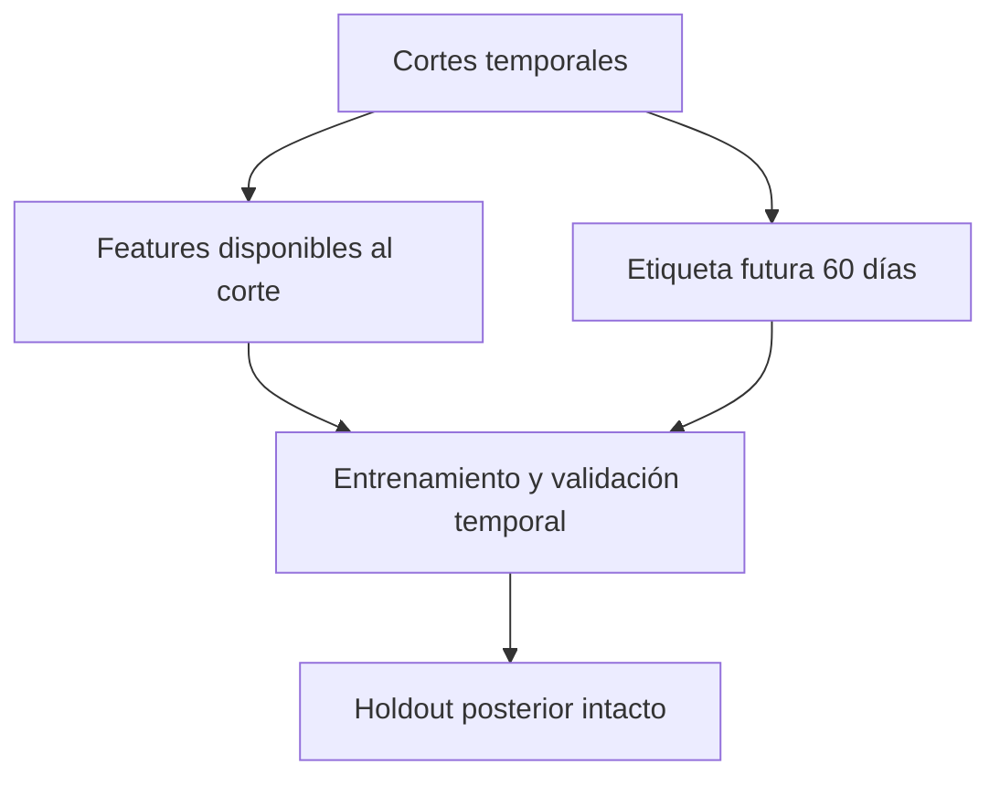

# Exploración predictiva del involucramiento

## Problema y trabajo declarado

La iniciativa buscaba explorar el involucramiento futuro en programas. La documentación describe consolidación de variables y cruces analíticos, prototipos y uso de RStudio y Power BI. Menciona técnicas supervisadas como parte del trabajo relatado.

## Alcance acreditable

Las capturas y el texto respaldan la preparación de información y la existencia de una exploración. No se dispone de código original, conjunto de entrenamiento, partición temporal, línea base, hiperparámetros ni métricas de evaluación. Las afirmaciones de precisión del relato no pueden verificarse.

No se presenta una regresión, árbol o red neuronal nueva como si fuera el modelo laboral original. Tampoco se publican variables internas, cantidades por programa ni predicciones históricas.

## Resultado y aprendizaje

Trazabilidad H08: PARCIAL para exploración documentada; rendimiento, generalización y operación productiva NO ACREDITADOS. El aporte defendible es la integración de información y formulación de preguntas analíticas.

Una continuación actual requeriría definir unidad y horizonte, separar datos disponibles antes de la predicción, comparar contra una línea base y evaluar fuera de muestra. Son requisitos propuestos y no pruebas realizadas. La evidencia disponible no permite calificar este caso como machine learning senior.

## ¿Cómo lo abordaría hoy? Evolución técnica y profesional (2026)

### Histórico y decisión actual

Mantendría la formulación de preguntas y preparación de información que desarrollé con RStudio y Power BI (págs. 32–37). El material no permite verificar precisión, entrenamiento ni generalización. Esa ausencia de evaluación es un límite demostrado de la evidencia disponible, no una prueba de que el modelo histórico fallara. Hoy no publicaría una supuesta solución predictiva validada sin etiqueta y evaluación defendibles.

| Pregunta | Requisito | Viabilidad |
|---|---|---|
| ¿Puede anticiparse falta de actividad en próximos 60 días? | Definición de actividad, fecha de corte y ventana completa | Requiere datos y aprobación de propósito |
| ¿Mejora una línea base de prevalencia? | Holdout temporal, etiqueta observada, métricas | Requiere experimento |
| ¿La predicción debe decidir elegibilidad social? | Evaluación ética y garantías institucionales | No justificable con el caso |

### Arquitectura y evaluación propuestas

Grano: persona elegible–corte. ETL congelaría features conocidas a esa fecha y construiría etiqueta solo después de completar 60 días de observación. Separar conjuntos por tiempo; si hay cortes repetidos por persona, probar además generalización a personas nuevas. Unir información futura, usar estado final o incluir un resultado intermedio produciría fuga. Mantener linaje de fechas y lista de columnas excluidas.

Línea base: prevalencia o última actividad, comparada con regresión logística antes de modelos más complejos. Evaluar PR-AUC para desbalance, calibración/Brier y precisión–recall al presupuesto real de revisión; reportar intervalos y desempeño por grupos donde sea legítimo y seguro. El umbral dependería de costos y capacidad humana, no del mejor número en test. DAX serviría para supervisar resultados agregados y cobertura de etiquetas, no para probar capacidad predictiva. M comprobaría uniones por persona/corte sin expansión y que `fecha_feature <= corte`.

### Riesgos, UX y mantenimiento

No mostrar scores nominales públicos. Diseñar una vista de incertidumbre, cobertura, cambio de población y errores; revisión humana y derecho a corregir información. Un modelo no debe reducir acceso a prestaciones ni estigmatizar personas. Versionar población, features y etiqueta; detener recomendaciones ante drift o pérdida de cobertura hasta revisión.

| Antes | Propuesta actual | Riesgo / trade-off | Prioridad y aceptación |
|---|---|---|---|
| Técnicas declaradas sin métricas replicables | Contrato de etiqueta + baseline | Puede concluir que no hay señal útil | P1: reproducir split y métricas sin fuga |
| Vistas exploratorias | Holdout temporal intacto | Menos datos para entrenar | P1: no ajustar umbral en test |
| Potencial de uso futuro | Revisión ética y humana | Limita automatización | P0: no decidir prestaciones automáticamente |

Estado: **IDEA + DISEÑO**, sin implementación predictiva. Se eligió invertir el desarrollo verificable en reporting de Formación y Educación Inicial: los datos disponibles no sustentan entrenar ni evaluar un modelo histórico.

### Estado de esta evolución

El trabajo histórico y la reconstrucción posterior se evalúan por separado. Las propuestas de seguridad y operación no acreditan funciones desplegadas durante mi experiencia laboral. No se publican capturas ni datos institucionales. Los documentos privados permiten contrastar el relato; las pruebas públicas corresponden exclusivamente a código nuevo y datos artificiales.
