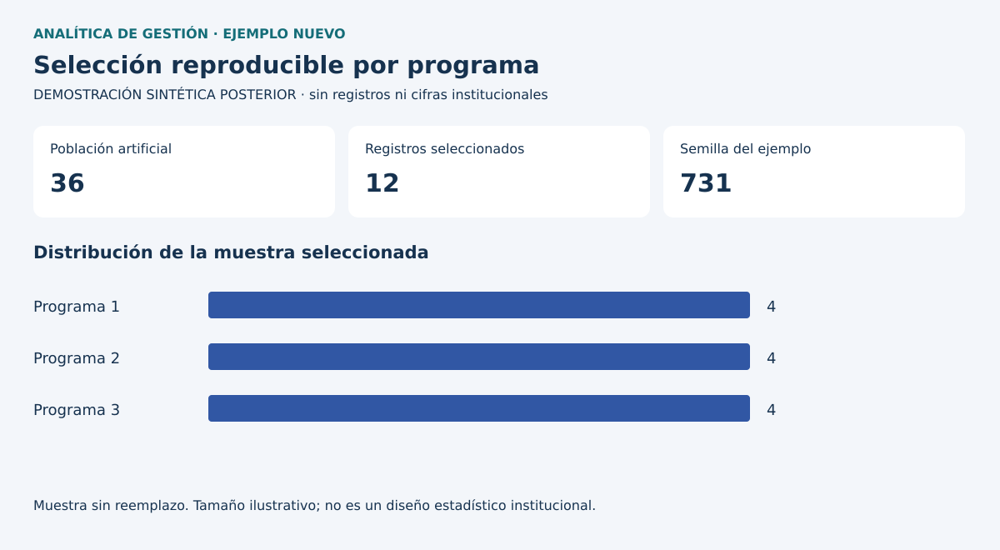

# Dos demostraciones posteriores

Son desarrollos nuevos de octubre de 2026 con asistencia de IA, sin datos institucionales ni calibración con las capturas.

## Formación

Una fila de `formacion.csv` representa una inscripción ficticia. `inscripcion_id` es único; `persona_id` puede repetirse. Los estados son Aprobado, En curso y Sin avance. Una bandera inventada señala presencia en un registro CRM ficticio. Los indicadores cuentan personas e inscripciones por separado y calculan tasa de aprobación sobre inscripciones.

La ausencia en CRM es una característica del registro sintético, no información del empleador. El generador no contiene nombres, contactos ni identificadores reales. La tasa no mide efectividad causal de formación.

## Muestra por programa

Una población artificial de programas abstractos y registros SIM se muestrea sin reemplazo, con semilla fija. La función rechaza IDs duplicados y estratos insuficientes. El resultado es reproducible independientemente del orden de entrada.

El tamaño por programa se fija para ilustrar la técnica y no responde a una estimación estadística ni a reglas de incentivos reales. No hay selección de beneficiarios ni decisiones sobre personas.



## Ejecución y Power BI

```bash
python src/demostracion.py
python -m unittest discover -s tests -v
```

Se generan CSV, JSON y SVG con biblioteca estándar. Para Power BI, importar `formacion.csv` como `FormacionDemo` con `powerbi/importar_formacion.pq` y revisar `powerbi/medidas_demo.dax`. DAX y M no han sido ejecutados en Desktop. No hay un PBIX público validado.
